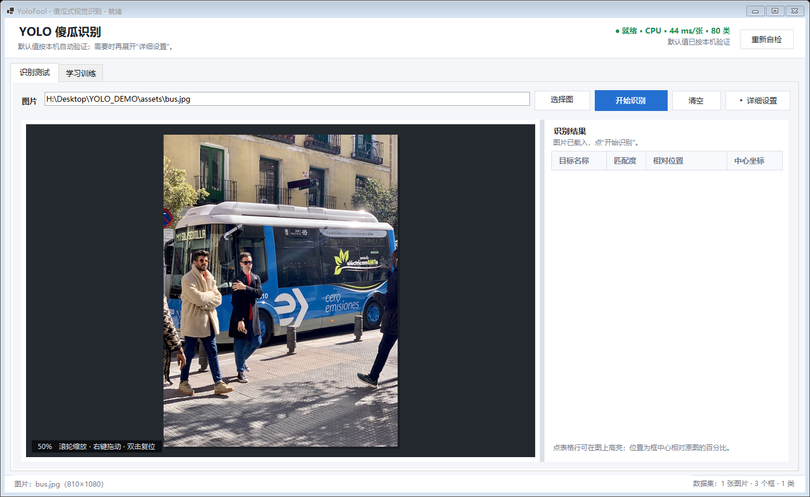

# YOLO 傻瓜版视觉识别（YoloFool）

面向产线 / 质检场景的 Windows 桌面视觉识别工具：**选模型 → 看图 → 框选命名 → 自动导出 YOLO 标签 → 训练 / 导出 / 切换模型**，全程不需要理解 YOLO 的目录结构。

- 主程序：`YoloFool`（WinForms / .NET 8 / C#；静态控件树在 `UI/MainForm.Designer.cs`，运行期只做样式、事件与数据填充）
- 推理引擎：DeploySharp + ONNX Runtime（CPU / Default，可探测 DirectML）
- 图像处理：OpenCvSharp4；中文拼音预览：ToolGood.Words
- 本机实测：`yolov8n.onnx`（COCO 80 类）CPU 预热后 **44–49 ms/张**



## 功能

| 模块 | 说明 |
|------|------|
| 启动自检 | 解析模型 → 加载 → 640×640 预热 → 样例图推理 3 次取中位数 → 探测可用后端，成功才在标题栏显示 `● 就绪 · CPU · xx ms/张 · N 类` |
| 单图识别 | 结果表四列：**目标名称 / 匹配度 / 相对位置 / 中心坐标(%)**；点行与画布框双向高亮，状态栏给出“位于画面左侧、中下”这类自然语言方位 |
| 学习 / 自动标注 | 打开图片 → 拖框 → 松手命名（中文 + 拼音预览）→ 自动复制图片到数据集、重写该图标签、更新 annotations；`classes.txt` **只追加不重排**，类别 id 永久稳定 |
| 训练 / 导出 / 切换 | 训练区固定在底部不滚出屏幕；导出失败不覆盖 `mymodel.onnx`；新模型加载失败自动保留旧模型 |
| 结果筛除 | 面积 / 长宽比 / 同类去重 / 视频连续帧确认 / 类别屏蔽 |
| 视频分析 | 跟踪 + 分割面积统计，按任务（seg / det）切换模型与阈值 |

设计原则：**默认即正确、危险操作后置、结果说人话、一步一提示、失败可回退**。详见 [docs/软件方案.md](docs/软件方案.md)。

## 目录结构

```
YOLO_DEMO/
├── YoloFool/               # 主程序（UI/ 界面，Core/ 推理·数据集·训练·视频）
├── YoloHeadlessDemo/       # 无界面推理示例（控制台）
├── tools/                  # 诊断/验证小程序：UiSnap、YoloProbe、YoloSmoke、CameraProbe
├── docs/                   # 软件方案与验收报告、视频分析说明、界面截图
├── assets/                 # 示例图（bus.jpg / result.jpg）
├── my_models/   (忽略)     # 运行期：mymodel.onnx、model_info.json、备份
├── mydataset/   (忽略)     # 运行期：images/labels/classes.txt/annotations.json/data.yaml
└── samples/     (忽略)     # 本机样例：camera / needle-bed / video
```

> 仓库只包含**源码与文档**。`bin/`、`obj/`、`.vs/`、Python venv、模型权重（`*.onnx`/`*.pt`）、数据集与采集样本均被 [.gitignore](.gitignore) 排除；`DeploySharp/`、`DeploySharpV1/` 是上游 [guojin-yan/DeploySharp](https://github.com/guojin-yan/DeploySharp) 的本地克隆，也不入库。

## 快速开始

环境：Windows 10/11 x64、[.NET 8 SDK](https://dotnet.microsoft.com/download/dotnet/8.0)。

```bash
# 构建
dotnet build YoloFool/YoloFool.csproj -c Release

# 运行
dotnet run --project YoloFool
```

首次运行前准备模型（仓库不分发权重）：

- 把 `yolov8n.onnx` 放到 `assets/`，或把自己的模型放到 `my_models/mymodel.onnx`；
- 程序会在工作区（含 `my_models`/`mydataset` 的上级目录）内解析路径，设置保存在程序目录的 `settings.json`；
- 详细设置默认折叠，改完必须“验证并保存”才会生效——验证失败保留原配置。

数据集目录（程序自动创建）：

```
mydataset/
├── images/            # 训练图片
├── labels/            # YOLO 标签（每图一个 .txt）
├── classes.txt        # 类别表，只追加不重排
├── annotations.json   # 框选标注元数据
└── data.yaml          # 训练配置
```

## 文档

- [docs/软件方案.md](docs/软件方案.md)：需求评估、布局问题根因、实现与验收细节
- [docs/视频分析.md](docs/视频分析.md)：视频任务、跟踪与面积统计说明

## 已知限制

- 本机仅 CPU 可用：DirectML 探测报 `887A0004`，程序只把它作为探测结果展示，不选为默认。
- 构建时有 2 个 `NU1701` 警告，来自 DeploySharp 传递依赖的 `iTextSharp 5.5.13.5`，可忽略。
- 界面用 `TableLayoutPanel`/`Dock` 做 DPI 自适应布局：静态控件树在 `YoloFool/UI/MainForm.Designer.cs`，样式/事件/数据在 `YoloFool/UI/MainForm.*.cs` 各页 partial。

## 第三方

[DeploySharp](https://github.com/guojin-yan/DeploySharp)、[ONNX Runtime](https://github.com/microsoft/onnxruntime)、[OpenCvSharp](https://github.com/shimat/opencvsharp)、[ToolGood.Words](https://github.com/toolgood/ToolGood.Words)。
