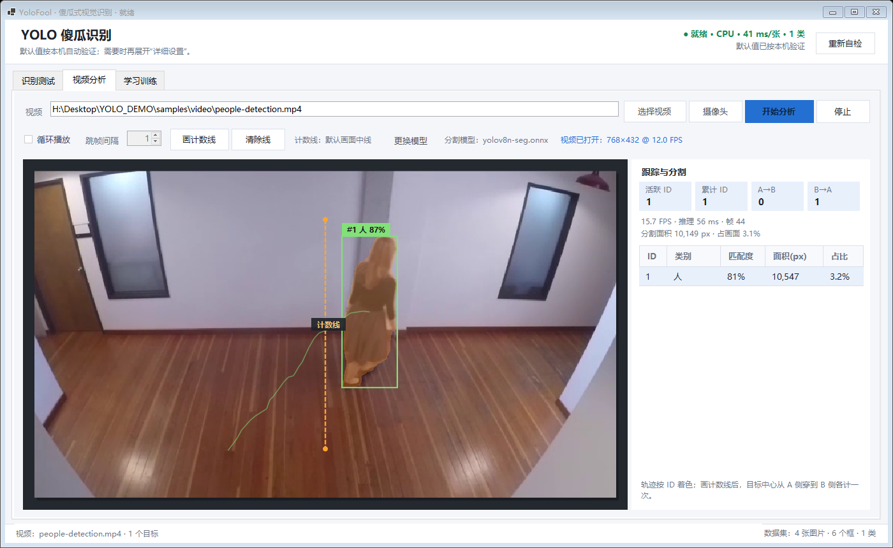
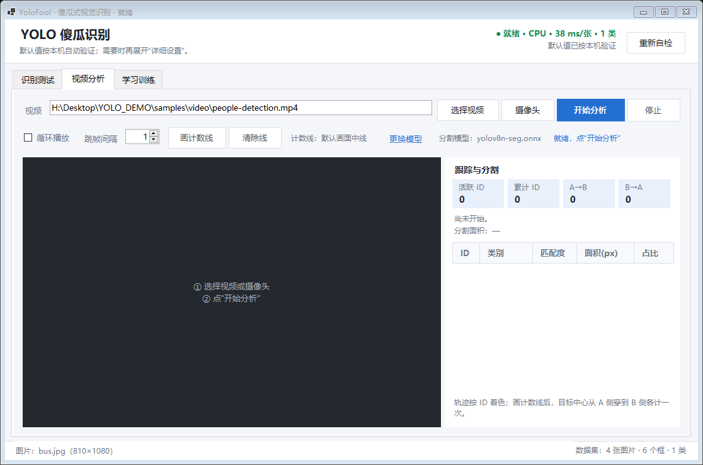

# 视频分析：跟踪 + 分割面积 + 越线计数

- 日期：2026-11-16
- 程序：`YoloFool`（WinForms / .NET 8）
- 入口：主界面 **视频分析** 页
- 模型：`demo/models/yolov8n-seg.onnx`（COCO 80 类实例分割，CPU/Default）
- 样本：`samples/video/*.mp4`



---

## 1. 这一页能做什么

| 能力 | 说明 |
|---|---|
| 视频文件 / 摄像头 | 支持 mp4/avi/mkv/mov/wmv/m4v；摄像头输入填 `0` |
| 实例分割 | 每个目标输出轮廓掩码，按 32% 透明度叠加到画面 |
| 多目标跟踪 | 每个目标分配稳定 `#ID`，画出最近 48 个中心点轨迹 |
| 越线计数 | 默认画面垂直中线，目标中心从 A 侧到 B 侧 / B 侧到 A 侧分别计数 |
| 分割面积 | 当前帧所有掩码的正像素总数、占画面百分比；表格按目标列出面积/占比 |
| 跳帧 | 1–12 帧跳 1 帧，CPU 跟不上时可降负载 |
| 循环播放 | 演示时自动重播 |
| 计数线编辑 | “画计数线”后在画面上点起点、终点；可清除恢复默认线 |
| 更换模型 | 选择自定义分割 ONNX，路径写入设置，下次继续使用 |

右侧指标：**活跃 ID / 累计 ID / A→B / B→A**；下方表格：ID、类别、匹配度、面积(px)、占比。

---

## 2. 使用步骤

0. 运行 `YoloFool\bin\Release\net8.0-windows\YoloFool.exe`，或 `dotnet run --project YoloFool`。
1. 打开程序，等标题栏出现 `● 就绪`（自检完成）。
2. 切到 **视频分析** 页；默认已填 `samples/video/people-detection.mp4`。
3. 点 **开始分析**。模型加载约 1 秒，随后画面开始刷新。
4. 第一帧会自动生成一条垂直计数线；也可以点 **画计数线**，在画面上点起点、再点终点。
5. 观察右侧计数；点 **停止** 结束。
6. 摄像头：点 **摄像头**（等价于输入 `0`），或把路径框改成 `0` 再开始。

> 计数线必须与目标运动方向相交。默认线在画面正中，适合“人从左边走到右边”这类场景。

---

## 3. 实现结构

```
UI/MainForm.Video.cs      视频页 UI、按钮、定时器、计数线编辑
UI/ImageCanvas.cs         新增 SetFrame / Tracks / LineA / LineB / LineDrawn
Core/VideoTracking.cs     VideoRunner（后台线程）+ SimpleTracker + LineCounter + VideoFrame
Core/SegMask.cs           SegMaskInfo（掩码 + 面积）+ MaskRenderer（透明叠加）
Core/InferenceService.cs  Predict(Mat) 增加 SegResult.Mask → byte[] 分支
Core/ModelTypes.cs        PredictionResult 增加可选 Masks
AppSettings.cs            LastVideoPath / VideoModelPath / VideoLoop / VideoFrameStep
AppPaths.cs               DefaultSegModel / VideoSamplesDir / DefaultVideo
```

### 3.1 线程模型

- `VideoRunner` 在后台线程里：`InferenceService.Load + Warmup` → `VideoCapture` → 读帧 → 跳帧 → 分割推理 → 跟踪 → 越线 → 掩码合成 → `Publish(最新帧)`。
- UI 用 33 ms 的 `System.Windows.Forms.Timer` 调 `TakeLatest()`，**只取最新一帧**，不排队、不逐帧等待；推理慢时自动丢帧，界面不卡。
- `Stop()` 取消 `CancellationToken` 并 `Join(3000)`；关闭窗体时 `ShutdownVideo()` 兜底。
- 所有跨线程 UI 更新走 `BeginInvokeSafe()`。

### 3.2 跟踪

`SimpleTracker`：

- 只匹配同一 `ClassId`；
- IoU ≥ 0.2 的候选按 IoU 从大到小贪心匹配；
- 未匹配检测新建 ID；
- 连续 `MaxAge=10` 帧未匹配才删除；
- 每个轨迹保留最近 48 个中心点；
- `CreatedCount` 即“累计 ID”。

这是轻量 IoU 跟踪，不依赖 ReID/卡尔曼；优点是零额外模型、CPU 开销小，缺点是遮挡后可能换 ID。

### 3.3 越线计数

`LineCounter` 用轨迹最后两个中心点：

- 用叉积判断点在计数线 A→B 的哪一侧；
- 前后两帧符号变化且线段相交，才认为穿越；
- 按方向累计 `AtoB` / `BtoA`；
- 同一个 ID 每穿越一次计一次。

### 3.4 分割面积

- `SegResult.Mask` 是 `ImageDataF`（浮点图），`GetRawFloatData()` 后 `>0.5` 记为前景；
- DeploySharp 的掩码可能是 **bbox 大小**（本机实测 `137×116`），不是全图；`SegMaskInfo` 记录 `MaskWidth/MaskHeight`，非全图时按 bbox 比例换算面积；
- 面积 = 前景像素数 ×（bbox 宽/掩码宽）×（bbox 高/掩码高），最后 clamp 到画面像素；
- 占比 = 面积 / (图像宽×高) × 100%；
- `MaskRenderer` 用 OpenCV 把掩码缩放到 bbox、按颜色 32% 叠加，再合成回整帧。

> 面积是**图像像素面积**，不是物理面积。要得到 mm²，需要标定：放一个已知尺寸的标定块，算出 `mm/px`，再乘 `(mm/px)²`；有透视时还要做单应性校正。

---

## 4. 本机实测

环境：Windows x64，CPU（NVIDIA Quadro P620 的 DirectML 在本机不可用），`yolov8n-seg.onnx`，输入 640×640，conf 0.35，nms 0.5。

| 指标 | 结果 |
|---|---|
| 单帧推理 | 46–61 ms（与画面内容有关） |
| UI 显示帧率 | 13.5–16.8 FPS（源视频 12 FPS） |
| 跟踪 | `people-detection.mp4` 稳定输出 `#1 人`，轨迹连续 |
| 越线 | 长跑 240 帧：`A→B=1`、`B→A=1`、累计 ID=5 |
| 分割面积 | 单目标 9,299–28,464 px（2.8%–8.6%），随目标远近变化 |
| 掩码 | 人物轮廓正确，透明叠加不遮死原图 |
| 表格 | `1 / 人 / 81% / 10,547 / 3.2%` |

端到端冒烟（`tools/YoloSmoke`）结果：

```text
PASS  视频帧已产出
PASS  跟踪到目标
PASS  分割掩码面积 > 0
PASS  视频截图已保存
ALL PASS
```

UI 冒烟（`tools/UiSnap`）结果：

```text
stats=15.7 FPS · 推理 56 ms · 帧 44
area=分割面积 10,149 px · 占画面 3.1%
rows=1
AtoB=0 BtoA=1
1 | 人 | 81% | 10,547 | 3.2%
```



---

## 5. 演示素材

| 文件 | 规格 | 用途 |
|---|---|---|
| `samples/video/people-detection.mp4` | 768×432，12.0 FPS，49.7 s | 多人进出，跟踪 + 越线计数 |
| `samples/video/car-detection.mp4` | 768×432，12.5 FPS，30.2 s | 俯拍车辆，快速目标计数 |
| `samples/video/store-aisle-detection.mp4` | 720×404，59.94 FPS，65.4 s | 高帧率客流，演示跳帧 2–4 |
| `samples/video/sintel.mp4` / `bbb.mp4` / `city.mp4` | W3C 样本 | 备用/动画场景 |

原始来源：Intel IoT DevKit `sample-videos`（经 `ghfast.top` 镜像下载）；W3C 媒体样本。仅用于本地演示。

---

## 6. 验证命令

```bat
cd H:\Desktop\YOLO_DEMO
dotnet build YoloFool\YoloFool.csproj -c Release
dotnet run --project tools\YoloSmoke
dotnet run --project tools\UiSnap
```

- `YoloSmoke`：自检、单图推理、拼音、自动导出、训练集视图、视频跟踪/掩码/面积。
- `UiSnap`：识别页与视频页端到端截图，输出在 `tools/UiSnap/bin/Debug/net8.0-windows/snapshots/`。

---

## 7. 当前限制

1. **只有 COCO 80 类**：能识别人、车、公交车等；工业零件/缺陷需要自训练分割模型。
2. **面积是像素面积**：未做相机标定/透视校正，不能直接当 mm² 用。
3. **跟踪是 IoU 贪心**：遮挡、交叉后可能换 ID；没有 ReID/卡尔曼平滑。
4. **单条直线计数**：不支持多边形区域/多区域/停留时长。
5. **CPU 性能**：768×432 约 13–17 FPS；1080p 需要跳帧或 GPU。
6. **RTSP 重连未做**：`VideoCapture` 能打开部分 RTSP，但断流后不会自动重连。
7. **未做录像/CSV 导出**：当前只做实时展示与截图。
8. **DirectML 不可用**：本机 P620 的 DML 初始化报 `887A0004`，默认走 CPU。

---

## 8. 下一步建议

- 用 Ultralytics 训练自定义 `yolov8n-seg`（多边形标注），导出 ONNX 后在“更换模型”里加载；
- 加标定块/单应性，输出 mm²；
- 计数线升级为多边形区域 + 停留时长 + 多区域；
- 加录像（带框/掩码）、CSV 事件导出；
- 加 RTSP 断线重连与摄像头选择；
- 有 CUDA 显卡时切 GPU 推理，或加 `yolo track` 的 BoT-SORT/ByteTrack 方案。
