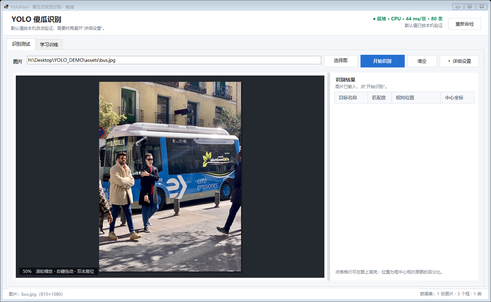
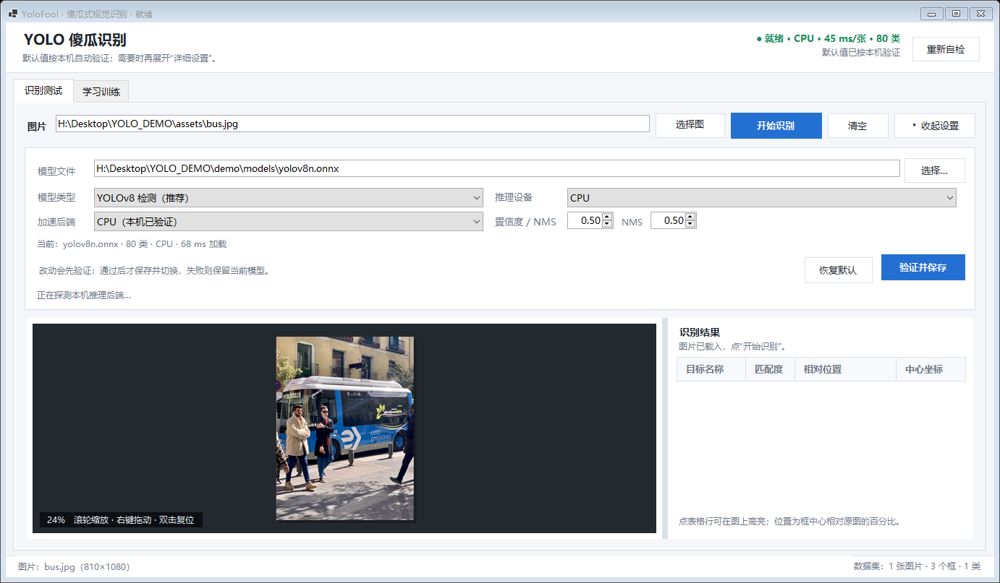
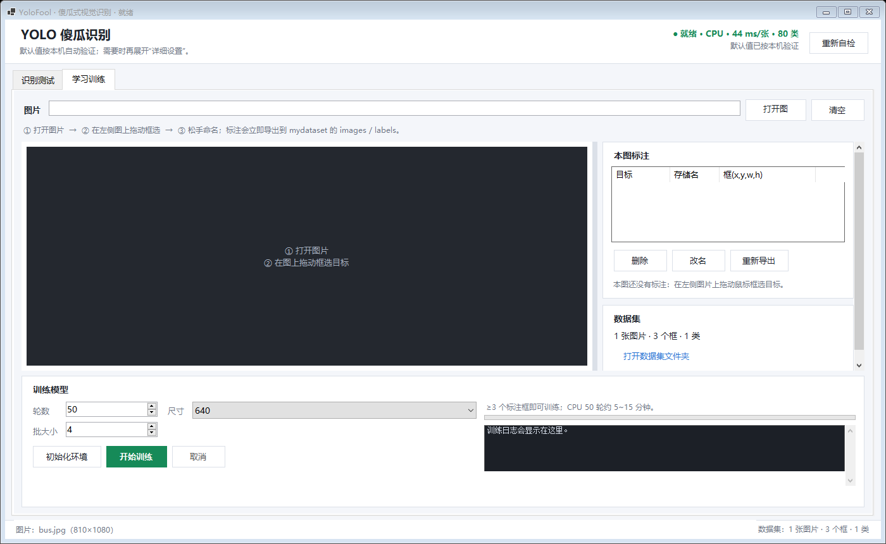
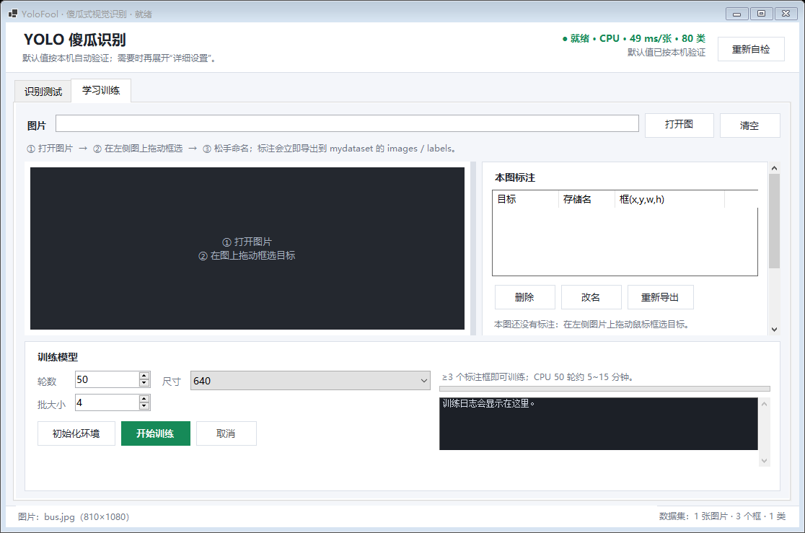
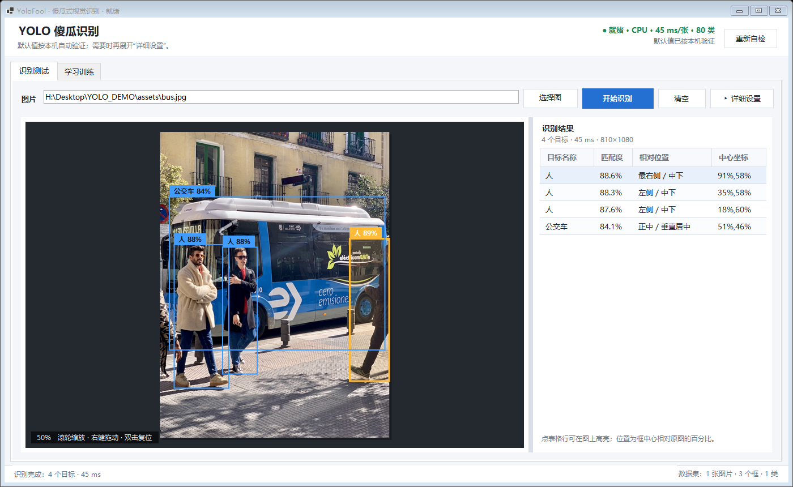

# YOLO 傻瓜版视觉识别 —— 软件方案与验收报告

- 日期：2026-11-16
- 适用程序：`YoloFool`（WinForms / .NET 8）
- 本机：Windows 10/11 x64，1680×1050，DPI 96，CPU 推理，NVIDIA Quadro P620
- 旧版备份：`backup/YoloFool_v1/`（原始 Designer 版，可随时对照）

---

## 0. 结论

1. 原程序的“按钮被遮挡”不是某一个控件写错，而是 **绝对坐标 + 字体自动缩放 + 固定面板高度 + 固定分隔条** 四件事叠加出来的布局事故。只在 Designer 里挪几个坐标，换一台 DPI 不同的机器还会再犯。
2. 本版不再修补 Designer，而是 **整窗代码优先重建**：`TableLayoutPanel`/`Dock`/`AutoSize` 负责布局，缩放交给 DPI 机制，详细设置面板按内容自动长高，学习页训练区固定在底部，永不滚出屏幕。
3. 5 条“傻瓜版”需求全部落地，并在本机跑通：模型自检 → 单图识别 → 名称/匹配度/相对位置/中心坐标 → 框选命名 → 自动导出 YOLO 标签 → 训练/导出/切换模型。
4. 本机实测：`yolov8n.onnx`（COCO 80 类）CPU/Default 预热后 **44–49 ms/张**；`bus.jpg` 识别出 4 个目标，结果与画布一致。
5. 构建结果：**0 error，2 个 NU1701 警告**（`iTextSharp 5.5.13.5` 以 .NET Framework 方式还原，DeploySharp 传递依赖，可忽略）。
6. 模型类型新增 **YOLO26 检测（端到端）**：同一张 `bus.jpg`、同一台 CPU，`yolo26n` 端到端 ONNX 稳态 **≈44 ms/张**，`yolov8n` 约 56 ms（快约 21%），且无 NMS 后处理。利弊与实现细节见 §15。



---

## 1. 原始需求评估

| # | 原始需求 | 原实现的问题 | 本版做法 | 结论 |
|---|----------|--------------|----------|------|
| 1 | 模型选择走默认（需验证本机），展开详细设置后才可调、可保存 | 默认值只是写死路径；启动加载失败只弹框；没有“本机验证”概念；保存后才发现模型不可用 | 启动自检：解析模型 → 加载 → 640×640 预热 → 样例图推理 3 次取中位数 → 探测后端；成功才把 `● 就绪 · CPU · xx ms/张 · N 类` 写到标题栏。详细设置默认折叠；只有“验证并保存”验证通过才写 `settings.json` 并切换 | 已实现 |
| 2 | 图像选择不变 | 路径框与三个按钮重叠，视觉上按钮像被输入框吞掉 | 保留“路径框 + 选择图 + 开始识别 + 清空”；启动自动载入上次图片/样例图；识别后保留路径 | 已实现 |
| 3 | 核心参数走默认（需验证本机），展开详细设置后才可调、可保存 | 置信度/NMS 直接暴露在主界面；改完只写文件，坏模型会污染下次启动 | 默认 `conf=0.5 / nms=0.5 / CPU / Default`；全部收进折叠面板；同样“验证并保存”，失败保留当前模型；提供“恢复默认” | 已实现 |
| 4 | 追加模型学习工具：框选后自动导出到默认文件，并可以命名目标 | 需要手动点“保存标注到数据集”；类别 id 用 `classes.IndexOf()` 现算，新增类别会让旧标签整体错位 | 框选松手 → 命名对话框（中文 + 拼音预览）→ 立即复制图片到 `mydataset/images`、重写该图 `mydataset/labels/<stem>.txt`、保存 annotations；`classes.txt` **只追加不重排**，类别 id 永久稳定；删除/改名/重新导出都会同步重写 | 已实现 |
| 5 | 执行测试时输出目标名称、相对图像位置、匹配度 | 只有“匹配度 / 位置(百分比) / 像素框”三列，没有“相对图像位置”的自然语言描述 | 结果表四列：**目标名称 / 匹配度 / 相对位置 / 中心坐标(%)**；点行或点框双向高亮，状态栏给出“位于画面左侧、中下（横向 35.0% / 纵向 58.0%）”；画布上直接画中文标签 | 已实现 |

### 1.1 五个“傻瓜化”原则

- **默认即正确**：能自检的默认值绝不让人填；本机不可用的后端（DirectML）只作为探测结果展示，不选为默认。
- **危险操作后置**：改设置不是“改完就生效”，而是“先验证、再保存、再切换”。
- **结果说人话**：不只给像素坐标，还给“最右侧 / 中下”这种能直接读的方位。
- **一步一提示**：学习页顶部固定三步提示“打开图片 → 拖框 → 松手命名”；导出是自动的，不要求用户理解 YOLO 目录。
- **失败可回退**：新模型加载失败保留旧模型；旧模型有备份；训练导出失败不覆盖 `mymodel.onnx`。

---

## 2. “按钮被遮挡”根因排查

### 2.1 现场取证方法

用独立诊断程序 `tools/UiSnap` 加载真实的 `MainForm`（放到屏幕外，`ShowInTaskbar=false`），在 1384×821、1100×700、1680×1010、1366×768 四种客户区尺寸下：

- `Graphics.DrawToBitmap` 逐页截图；
- 递归打印每个控件的 `Bounds / Parent / Text / Visible` 到 `bounds_*.txt`；
- 对“子控件 bottom 超过父容器 height”的情况标 `OVERFLOW-Y`。

这样不改生产代码，也能把“设计坐标”和“运行时实际坐标”对上。

### 2.2 四个叠加的根因

**根因 A：设计基准字体与实际字体不一致，整窗被悄悄放大 1.143 倍**

- 旧窗体：`AutoScaleDimensions = (7F, 17F)`、`AutoScaleMode = Font`、运行字体 `Microsoft YaHei UI 10pt`。
- 实际运行字体度量与设计基准不一致，WinForms 在 96 DPI 下就按 **1.143 倍** 缩放：设计 X=60 → 实际 69，宽 560 → 640，X=628 → 718。
- 顶部面板设计宽 1368，缩放后坐标系变成约 **1563**，但 `Dock=Top` 实际只有 **1376** 宽。
- 右锚点按钮的右边距是按 1563 算出来的，再塞进 1376 的父容器，整组按钮左移约 **97 px**：
  - `btnSelectImage` 设计 x=628 → 实际 x=531
  - `btnRun` 设计 x=712 → 实际 x=627
  - `btnToggleAdv` 设计 x=884 → 实际 x=823
- 也就是说：**设计器里排好的关系，在运行时已经全部错位**；DPI 越高，错位按比例越大。

**根因 B：路径输入框横穿按钮区**

- `tbRecImage` 设计 x=60、宽 560（右边到 620），锚点 `Top|Left|Right`。
- 父容器变宽后，它被拉成 **x=69、宽 1147（右边到 1216）**，正好从三个按钮下方穿过。
- 按钮层级虽然在上，但视觉上变成“按钮浮在一个巨大的输入框上”，右侧还露出一段空白输入框（977–1216）。用户看到的“按钮被遮挡/界面坏了”主要来自这里。

**根因 C：详细设置面板高度写死 140，缩放后内容需要约 160**

- `pnlAdv` 设计高 140；AutoScale 后内部控件整体变高，`lblAdvModelInfo` 的 `Bounds.Y=130、H=20`，bottom=150。
- 但展开代码里写的是 `pnlAdv.Height = 140`，**又把已经缩放好的面板压回 140**，底部“当前模型……”一行被面板底边裁掉，bounds 文件直接标 `OVERFLOW-Y`。

**根因 D：固定分隔条 + 绝对 Y 坐标 + 没有滚动**

- 识别页 `SplitterDistance=580`、学习页 `=900` 写死；窗口变窄时右侧面板被压到 460，`lvBoxes` 从 438 缩到 366，“保存标注到数据集”按钮只剩 136 px。
- 学习页右侧所有控件用绝对 Y 坐标，没有 `AutoScroll`；700 高度时“训练模型”整块被挤出可视区。
- `MinimumSize=1100×700` 是**外框**尺寸，又被 AutoScale 放大，实测请求 1100×700 客户区得到 **1239×739**；1366×768 笔记本上窗口比工作区还高，底部自然看不见。

### 2.3 为什么“只在 Designer 挪坐标”解决不了

- `Anchor` 的边距是在缩放后的坐标系里算的，父容器宽度一变，按钮位置就跟着漂；
- 同一份坐标在 100% / 125% / 150% DPI 下会得到三种不同结果；
- 只要还有“写死高度/写死分隔条/绝对 Y 坐标”，换尺寸或换机器就会复现。

### 2.4 本版修复策略

| 旧做法 | 新做法 |
|--------|--------|
| Designer 绝对坐标 + Anchor | `TableLayoutPanel` 行列百分比 + `Dock`，窗口缩放由布局引擎算 |
| `AutoScaleMode.Font` + 设计字体度量 | `AutoScaleMode.Dpi` + `AutoScaleDimensions=(96,96)`，按 DPI 整体等比缩放，不再混用字体度量 |
| `pnlAdv.Height=140` | 面板 `AutoSize=true`，展开只切 `Visible`，高度由内容决定 |
| 固定 `SplitterDistance` | 先给 SplitContainer 初始 `Size`，再设 `Panel1MinSize/Panel2MinSize`，`SplitterDistance` 由布局计算 |
| 学习页右侧绝对 Y 坐标 | 训练区独立成底部通栏 `RowStyle=Absolute 216`，其余侧栏 `AutoScroll` |
| 外框 `MinimumSize` 硬扛 | 客户区按工作区计算：`min(1320, wa.W-40) × min(880, wa.H-40)`，最小 1000×620 |

---

## 3. 新界面布局

### 3.1 主窗体

```
┌──────────────────────────────────────────────────────────────────────┐
│ YOLO 傻瓜识别                                    ● 就绪 · CPU · 45ms/张 │
│ 默认值已按本机自动验证；需要时再展开“详细设置”。        [重新自检]      │
├──────────────────────────────────────────────────────────────────────┤
│ [识别测试] [学习训练]                                                 │
│                                                                      │
│  ┌ 页面内容（随窗口缩放）──────────────────────────────────────────┐  │
│  │                                                                │  │
│  └────────────────────────────────────────────────────────────────┘  │
├──────────────────────────────────────────────────────────────────────┤
│ 图片：bus.jpg（810×1080）                    数据集：1 张图片 · 3 个框 │
└──────────────────────────────────────────────────────────────────────┘
```

- 三行根布局：Header（AutoSize）/ Tab（100%）/ 状态栏（30 px）。
- 标题栏启动时只显示 `YoloFool · 傻瓜式视觉识别`；自检结束后追加 `· 就绪` 或 `· 加载失败`，避免自动化工具把“加载中”误判为完成。
- 启动**不弹 MessageBox**：失败只写状态栏和日志，用户仍能进“详细设置”修模型。

### 3.2 识别测试页

```
┌ 图片 [ H:\...\bus.jpg                              ] [选择图] [开始识别] [清空] [▸ 详细设置] ┐
│                                                                                            │
│ ┌───────────────────────────────┐  ┌ 识别结果 ──────────────────────────┐                │
│ │                               │  │ 4 个目标 · 45 ms · 810×1080        │                │
│ │         图片画布              │  │ 目标名称 │ 匹配度 │ 相对位置 │ 中心坐标 │                │
│ │   （缩放/拖动/选中高亮）      │  │ 人       │ 88.6% │ 最右侧/中下 │ 91%,58% │                │
│ │                               │  │ 人       │ 88.3% │ 左侧/中下   │ 35%,58% │                │
│ │                               │  │ 公交车   │ 84.1% │ 正中/垂直居中│ 51%,46% │                │
│ └───────────────────────────────┘  └────────────────────────────────────┘                │
└────────────────────────────────────────────────────────────────────────────────────────────┘
```

- 工具条 6 列：标签 / 路径框（Fill）/ 选择图 / 开始识别（主色 126×36）/ 清空 / 详细设置。
- 画布：滚轮以鼠标为中心缩放（2%–1200%），右键/中键拖动平移，双击复位；左键框选只在学习页启用。
- 结果表：点行 → 画布对应框变琥珀色；点画布框 → 表格选中对应行；状态栏同步显示自然语言方位。
- 状态文案：未识别“图片已载入，点‘开始识别’。”；识别后“N 个目标 · xx ms · 宽×高”；无目标给出降低阈值的提示。

**详细设置（默认折叠）**

```
┌ 模型文件 [ H:\...\yolov8n.onnx                          ] [选择...] ┐
│ 模型类型 [YOLO26 检测（端到端）▼] 推理设备 [CPU ▼]                  │
│ 加速后端 [CPU（本机已验证）▼]     置信度 / NMS [0.50] NMS [0.50]    │
│ 当前：yolov8n.onnx · 80 类 · CPU · 69 ms 加载                        │
│ 改动会先验证：通过后才保存并切换，失败则保留当前模型。  [恢复默认] [验证并保存] │
│ 正在探测本机推理后端…（Default 可用 / DirectML 不可用：887A0004）    │
└──────────────────────────────────────────────────────────────────────┘
```

- 面板 `AutoSize`，不再有固定 140 的高度；入口按钮文字在“▸ 详细设置 / ▾ 收起设置”间切换。
- 只有“验证并保存”会动 `settings.json`；验证失败会给出具体异常，当前模型继续可用。
- “恢复默认”只重置表单，不立刻写盘；仍需点“验证并保存”。
- 模型类型下拉 4 项：YOLOv8 检测（推荐）/ YOLOv11 检测 / YOLOv8 分割 / YOLO26 检测（端到端）。选错也能自动纠正：加载前 `OnnxInspector` 会读 ONNX 元数据（`task`、`end2end`）和输出形状判型，不一致时以文件为准并提示。



### 3.3 学习训练页

```
┌ 图片 [                                          ] [打开图] [清空]  ┐
│ ① 打开图片 → ② 在左侧图上拖动框选 → ③ 松手命名；标注会立即导出。   │
│ ┌────────────────────────────┐  ┌ 本图标注 ───────────────────┐  │
│ │                            │  │ 目标 │ 存储名 │ 框(x,y,w,h)  │  │
│ │      图片画布（可框选）     │  │ 飞机 │ feiji  │ 626,166,...  │  │
│ │      绿色框=已标注          │  │ [删除] [改名] [重新导出]     │  │
│ │                            │  ├ 数据集 ────────────────────┤  │
│ │                            │  │ 1 张图片 · 3 个框 · 1 类     │  │
│ │                            │  │ 打开数据集文件夹            │  │
│ └────────────────────────────┘  └─────────────────────────────┘  │
├────────────────────────────────────────────────────────────────────┤
│ 训练模型                                                            │
│ 轮数[50] 尺寸[640▼] 批大小[4]  ≥3 个标注框即可训练；CPU 训练较慢    │
│ [初始化环境] [开始训练] [取消]   [阶段提示/进度条]                  │
│                                  ┌ 训练日志（深色，可滚动）──────┐   │
│                                  │ 训练日志会显示在这里。        │   │
└────────────────────────────────────────────────────────────────────┘
```

- 训练区固定在底部 216 px，**任何窗口高度都不会被挤出屏幕**；右侧栏只放“本图标注 / 数据集”，内容多时自身滚动。
- 框选松手 → `NameDialog`：可编辑下拉 + 拼音预览“训练用存储名：feiji”；同名复用，新名自动追加 `_2` 去重。
- 每次增删改都会立刻重写该图标签文件，列表/统计同步刷新；不需要再点“保存”。
- 训练前提示“≥3 个标注框即可训练；CPU 训练较慢”，避免误以为点了就秒出结果。



### 3.4 尺寸行为

| 场景 | 行为 |
|------|------|
| 启动（1680×1050 工作区） | 外框 `min(1320, 1640) × min(880, 970) = 1320×880`，居中 |
| 最小窗口 | 1000×620，工具条仍完整，训练区仍在底部 |
| 1366×768 笔记本 | 宽度 1320、高度 688，状态栏与训练按钮全部可见 |
| 手动拉宽 | 路径框/画布/结果表按百分比伸展；按钮不重叠 |
| 125% / 150% DPI | 整体按 DPI 等比缩放，布局由 TLP 重算（不再有 1.143 的“暗缩放”） |
| 侧栏内容超高 | 只有右侧栏滚动，底部训练区不滚动 |



---

## 4. 启动、自检与默认值

### 4.1 启动顺序

1. `AppSettings.Load()`：读 `settings.json`，夹取非法值（conf/nms 限制 0.01–0.99）。
2. `LabelCatalog.Load()`：内置 COCO 80 类中文名 + 用户 `labels_map.json` 覆盖。
3. `DatasetStore.Load()`：读 annotations / classes / export_map，兼容旧版小写盘符键。
4. `EnsureDirectories()`：补齐 `my_models / mydataset/images / labels / training / runs / logs`。
5. `BuildUi()` + `WireEvents()`。
6. 后台 `SelfCheck.Run()`：加载模型 → 640×640 预热 → 样例图推理 3 次取中位数；成功才把标题改为“就绪”，失败写“加载失败”并允许进详细设置。

### 4.2 默认值（本机已验证）

| 项 | 默认 | 说明 |
|----|------|------|
| 模型 | `demo\models\yolov8n.onnx` | 解析顺序：settings → `my_models\mymodel.onnx` → 内置 COCO → `my_models` 下任意 `.onnx` |
| 类型 | `YOLOv8Det` | 另支持 YOLOv11Det、YOLOv8Seg（分割结果按检测框展示） |
| 引擎 | OnnxRuntime | 本版固定，界面不暴露 |
| 设备 / 后端 | CPU / Default | 实测 44–49 ms/张 |
| 置信度 / NMS | 0.5 / 0.5 | 教程场景通用值 |
| 阈值验证 | 自检时用样例图实际推理 | 不是“能加载”就算过 |

### 4.3 后端探测结论（本机）

- `Default`：可用，CPU 约 45–50 ms/张。
- `DML`（GPU0）：不可用。`OnnxRuntimeException 887A0004 指定的设备接口或功能级别在此系统上不支持`，栈在 `dml_provider_factory.cc(549) AppendExecutionProvider_DML`；因此默认强制 CPU，DirectML 只作为可选探测项。
- `Dnnl`：不可用。`EntryPointNotFoundException: Unable to find an entry point named 'OrtSessionOptionsAppendExecutionProvider_Dnnl'`。

> 结论：这台机器上“走默认”必须是 CPU/Default；盲目选 GPU 会直接初始化失败。

---

## 5. 软件架构

```
YoloFool/
├─ Program.cs                    Application.Run(new MainForm())
├─ AppPaths.cs                   工作区/模型/数据集/日志路径解析
├─ AppSettings.cs                settings.json（SchemaVersion=2，原子写）
├─ AssemblyInfo.cs               InternalsVisibleTo 诊断工具
├─ Core/
│  ├─ ModelTypes.cs              YoloModelKind / ModelOptions / DetectionItem / PredictionResult
│  ├─ InferenceService.cs        DeploySharp 封装：安全换模型、预热、预测
│  ├─ SelfCheck.cs               启动自检、后端探测、默认模型解析
│  ├─ RelativePosition.cs        百分比 → “左侧 / 中下”自然语言
│  ├─ LabelCatalog.cs            COCO 中文名 + 自定义名 + 拼音存储名
│  ├─ ImageUtil.cs               图片过滤/安全加载（不锁文件）
│  ├─ DatasetStore.cs            annotations / classes / YOLO txt / 训练集视图
│  ├─ TrainingService.cs         yolo.exe 训练、导出、验证、部署
│  └─ Log.cs                     按天写 logs\app-yyyyMMdd.log
└─ UI/
   ├─ Theme.cs                   浅色主题、字体、卡片、表格/日志样式
   ├─ ImageCanvas.cs             自绘画布：缩放/平移/检测框/框选/中文标签
   ├─ NameDialog.cs              命名对话框（中文 + 拼音预览）
   ├─ MainForm.Designer.cs       静态控件树：外壳 + 6 个页签（设计器可打开）
   └─ MainForm.*.cs             各页样式、事件接线与数据填充（partial 分包）
```

**依赖方向**：`UI → Core → DeploySharp/OpenCvSharp`，Core 不引用 WinForms；推理/训练/IO 全部可脱离界面单测（`tools/YoloSmoke` 就是这么做的）。

**线程模型**：

- 推理、训练、模型验证都走 `Task.Run`；
- 回 UI 用 `Control.BeginInvoke`（训练事件、日志、进度）；
- 训练取消用 `Process.Kill(entireProcessTree: true)`，避免子进程残留；
- 退出时若正在训练，先确认再取消。

---

## 6. 数据结构与文件

### 6.1 `settings.json`（exe 同目录）

```json
{
  "SchemaVersion": 2,
  "ModelPath": "H:\\Desktop\\YOLO_DEMO\\demo\\models\\yolov8n.onnx",
  "ModelKind": "YOLOv8Det",
  "Engine": "OnnxRuntime",
  "Device": "CPU",
  "OnnxProvider": "Default",
  "Confidence": 0.5,
  "Nms": 0.5,
  "LastImagePath": "H:\\Desktop\\YOLO_DEMO\\assets\\bus.jpg",
  "LastLearnImagePath": "",
  "AdvancedExpanded": false,
  "TrainEpochs": 50,
  "TrainImageSize": 640,
  "TrainBatch": 4,
  "SelfCheckAt": "2026-11-16T16:06:00+08:00",
  "SelfCheckText": "yolov8n.onnx · 80 类 · CPU · 44 ms/张"
}
```

### 6.2 `mydataset\annotations.json`

键是**图片绝对路径**（统一 `Path.GetFullPath`，兼容旧版小写盘符）；值是框列表，坐标为原图像素：

```json
{
  "H:\\Desktop\\YOLO_DEMO\\demo\\images\\plane.png": [
    { "Cn": "飞机", "En": "feiji", "X": 626, "Y": 166, "W": 149, "H": 160 },
    { "Cn": "飞机", "En": "feiji", "X": 126, "Y": 338, "W": 239, "H": 211 }
  ]
}
```

### 6.3 其余文件

| 文件 | 作用 |
|------|------|
| `mydataset\labels_map.json` | `{英文存储名: 中文显示名}`，例如 `{"feiji":"飞机"}`；用户文件覆盖内置 COCO |
| `mydataset\classes.txt` | 类别表，**只追加不重排**；行号即 YOLO class id |
| `mydataset\export_map.json` | 原图名 → 导出安全名（中文/空格文件名映射） |
| `mydataset\images\<stem>.<ext>` | 导出图片（学习页框选后自动复制） |
| `mydataset\labels\<stem>.txt` | 每行 `classId cx cy w h`，归一化 0–1、6 位小数 |
| `mydataset\training\...` | 训练视图：`images\{train,val}` + `labels\{train,val}` |
| `mydataset\data.yaml` | Ultralytics 数据配置（正斜杠 path、nc、names） |
| `mydataset\runs\train_<时间>\` | 每次训练的权重、日志、曲线 |
| `my_models\mymodel.onnx` | 训练导出的“我的模型” |
| `my_models\backup\mymodel_<时间>.onnx` | 每次部署前的旧模型备份 |
| `my_models\model_info.json` | 模型来源、创建时间、epochs、类别列表 |
| `logs\app-yyyyMMdd.log` | 启动、自检、推理失败、训练阶段（Error 含完整堆栈） |

### 6.4 `data.yaml`

```yaml
path: H:/Desktop/YOLO_DEMO/mydataset/training
train: images/train
val: images/val
nc: 1
names: ['feiji']
```

- 图片数 ≥5 时按 20% 随机拆验证集（固定种子 20260501）；<5 时 `val: images/train`（同一批图，仅用于跑通流程，指标不可当真）。

---

## 7. 识别输出定义

每条 `DetectionItem`：`ClassId / RawCategory / Confidence / X,Y,W,H / ImageWidth,ImageHeight`。

- **目标名称**：优先 `labels_map.json` 的中文显示名，否则内置 COCO 中文名，再否则原始类别名。
- **匹配度**：模型置信度，显示为 `F1%`。
- **相对位置**：按框中心百分比分档：

| 横向 | 条件 | 纵向 | 条件 |
|------|------|------|------|
| 最左侧 | <15% | 最上方 | <15% |
| 左侧 | 15–35% | 偏上 | 15–35% |
| 中间偏左 | 35–45% | 中上 | 35–45% |
| 正中 | 45–55% | 垂直居中 | 45–55% |
| 中间偏右 | 55–65% | 中下 | 55–65% |
| 右侧 | 65–85% | 偏下 | 65–85% |
| 最右侧 | >85% | 最下方 | >85% |

- **中心坐标(%)**：框中心相对原图的百分比，表格显示 `横向%,纵向%`（`F0`，避免窄列截断）。
- **状态栏描述**：`RelativePosition.Describe` 输出“位于画面左侧、中下（横向 35.0% / 纵向 58.0%）”；正中且垂直居中时输出“位于画面正中心”。

---

## 8. 学习 / 训练闭环

### 8.1 标注（傻瓜流程）

1. “学习训练” → “打开图”选一张图（或自动载入上次学习图）。
2. 在左侧画布上拖动框选；松手弹出命名框。
3. 输入中文名 → 实时显示“训练用存储名：<拼音>” → 确定。
4. 程序立即：
   - 把框追加到 `annotations.json`；
   - 复制/覆盖图片到 `mydataset\images`；
   - 重写 `mydataset\labels\<stem>.txt`；
   - 若出现新类别，追加到 `classes.txt` 并写 `labels_map.json`；
   - 刷新右侧列表与“N 张图片 · M 个框 · K 类”。
5. 删除/改名/重新导出 → 同样立即重写，不需要二次保存。

### 8.2 训练

1. 点“初始化环境”：若 `tools\yolovenv\Scripts\yolo.exe` 已存在则直接跳过；否则创建 venv、装 CPU 版 torch + ultralytics、下载基础权重 `tools\yolov8n.pt` 与 `tools\yolo26n.pt`（后者下载失败只警告）。训练时若 `tools\yolo26n.pt` 存在则优先用它作 base（见 §15）。
2. 确认 ≥3 个标注框后点“开始训练”。
3. 生成训练视图与 `data.yaml` → 执行：

```
yolo detect train data=<data.yaml> model=tools\yolov8n.pt \
  epochs=50 imgsz=640 batch=4 device=cpu workers=0 \
  project=<mydataset>\runs name=train_<时间> exist_ok=True \
  patience=20 plots=False verbose=True
```

4. 训练完成后自动导出：

```
yolo export model=<run>\weights\best.pt format=onnx imgsz=640 opset=12 simplify=False nms=False
```

5. 新 ONNX **先加载 + 预热验证**；通过才：
   - 备份旧 `my_models\mymodel.onnx`；
   - 覆盖为新模型；
   - 写 `model_info.json`；
   - 更新 `settings.json` 并切换当前推理实例。
6. “取消”会杀掉整棵进程树；关窗时若在训练会先确认。

---

## 9. 本机验证记录

### 9.1 构建

```
dotnet build .\YoloFool\YoloFool.csproj
→ 0 Error(s)，2 Warning(s)（NU1701 iTextSharp 5.5.13.5，可忽略）
```

### 9.2 自检

- 模型：`H:\Desktop\YOLO_DEMO\demo\models\yolov8n.onnx`
- 类型/后端：`YOLOv8Det / CPU / Default`
- 类别：80（COCO）
- 加载：约 69–74 ms；预热后推理 44–49 ms/张

### 9.3 `bus.jpg`（810×1080）识别结果

| 目标 | 匹配度 | 相对位置 | 中心坐标 | 像素框 |
|------|--------|----------|----------|--------|
| 人 | 88.6% | 最右侧 / 中下 | 91%, 58% | 670,377,139,503 |
| 人 | 88.3% | 左侧 / 中下 | 35%, 58% | 221,407,122,448 |
| 人 | 87.6% | 左侧 / 中下 | 18%, 60% | 50,398,193,507 |
| 公交车 | 84.1% | 正中 / 垂直居中 | 51%, 46% | 33,229,761,541 |



### 9.4 端到端冒烟（`tools/YoloSmoke`）

全部 PASS：

- SelfCheck：模型/类型/后端/类数/耗时正确；
- 推理：bus.jpg 4 个目标，类别名、置信度、像素框、相对位置正确；
- `EnsureEnglish("公交车") → "bus"`（中文转拼音）；
- `AddBox(plane, "feiji", ...)` → 类别 id 3、生成 `plane.txt` 4 行、图片复制成功；`RemoveBox` 后行数恢复；
- `BuildTrainingView()` → `data.yaml`，train=1 / val=0 / classes=1。

### 9.5 UI 冒烟（真实消息循环）

`tools/UiSnap` 用 `Application.Run` + Timer 点击“开始识别”：

```
done=True timeout=False
rows=4
stats=4 个目标 · 45 ms · 810×1080
status=YoloFool · 傻瓜式视觉识别 · 就绪
人 | 88.6% | 最右侧 / 中下 | 91%,58%
人 | 88.3% | 左侧 / 中下 | 35%,58%
人 | 87.6% | 左侧 / 中下 | 18%,60%
公交车 | 84.1% | 正中 / 垂直居中 | 51%,46%
```

> 排查插曲：早期 UiSnap 用 `Show()+DoEvents` 起窗，`await` 续体落到线程池，`_lblStatus.Text` 在非 UI 线程触发 `Win32Exception 0x80004005 创建窗口句柄时出错`。改用真实消息循环后消失；生产 `Application.Run` 路径不存在该问题。

### 9.6 截图

| 文件 | 内容 |
|------|------|
| `docs/images/01-recognize.png` | 识别页默认 1400×860（含状态栏） |
| `docs/images/02-recognize-results.png` | 识别 4 个目标、选中框高亮 |
| `docs/images/03-advanced.png` | 1366×768 展开详细设置 |
| `docs/images/04-learn.png` | 学习页默认 |
| `docs/images/05-learn-small.png` | 1100×700 学习页（训练区仍完整） |
| `docs/images/06-recognize-small.png` | 1100×700 识别页 |

---

## 10. 验收清单

- [x] 启动自动加载默认模型并自检，标题显示“就绪/加载失败”
- [x] 默认模型/参数不展开即可用；详细设置默认折叠
- [x] 修改设置必须“验证并保存”，失败保留当前模型
- [x] 选择图片、开始识别、清空、路径回显正常
- [x] 识别结果含名称/匹配度/相对位置/中心坐标
- [x] 表格与画布双向高亮
- [x] 学习页框选即命名、即导出，无需手动保存
- [x] 类别 id 只追加不重排，旧标签不会错位
- [x] 删除/改名后标签文件同步重写
- [x] 训练集视图、data.yaml、训练/导出/验证/备份/切换闭环
- [x] 1384×821 / 1100×700 / 1366×768 / 1680×1010 无控件重叠、无 OVERFLOW-Y
- [x] 学习页训练按钮在最小窗口仍可见
- [x] 构建 0 error
- [x] 端到端冒烟与 UI 冒烟通过

---

## 11. 运行方式

```powershell
# 构建
dotnet build .\YoloFool\YoloFool.csproj -c Release

# 运行
.\YoloFool\bin\Release\net8.0-windows\YoloFool.exe
```

- 需要 .NET 8 Desktop Runtime；`OpenCvSharp4.runtime.win` 与 `Microsoft.ML.OnnxRuntime.DirectML` 的原生 DLL 由 NuGet 复制到输出目录。
- 数据目录默认按 exe 向上查找包含 `demo`/`mydataset` 的工作区根；也可设环境变量 `YOLO_DEMO_HOME=H:\Desktop\YOLO_DEMO`。
- `settings.json` 在 exe 同目录；换机器/换目录时，删掉它即可回到默认自检流程。

### 诊断工具

```powershell
dotnet run --project .\tools\YoloSmoke   # 无界面端到端自检
dotnet run --project .\tools\UiSnap      # 生成布局截图 + UI 冒烟
```

`YoloSmoke` 会临时增删 `mydataset` 标注并在结束时清理测试图片，运行前建议先备份 `annotations.json`。

---

## 12. 已知限制与后续建议

1. **本机只能用 CPU**：DirectML 驱动不支持（887A0004），不要默认选 GPU；换机器后可用“重新自检”+详细设置再验证。
2. **模型格式**：只支持 Ultralytics 导出的 ONNX 检测/分割模型；类别名依赖 ONNX 元数据 `names`，缺失时显示数字 id。
3. **分割模型**：单图识别页仍按检测框输出；视频页已支持掩码叠加与面积统计（见 `docs/视频分析.md`）。
4. **训练是 CPU 单机**：50 epochs、batch 4，耗时随图片数增长；界面只暴露轮数/尺寸/批大小，未提供数据增强、断点续训、早停配置。
5. **小数据集验证集**：<5 张时 `val=train`，只保证流程可跑，指标不代表泛化能力。
6. **中文名**：内置 COCO 80 类中文；自定义类通过命名对话框写入 `labels_map.json`，拼音由 ToolGood.Words 生成，生僻字可能得到不理想拼音，可在 `labels_map.json` 手动改。
7. **未包含**：批量文件夹、拖拽打开、安装包/自动更新。摄像头/视频流已在“视频分析”页支持，详见 `docs/视频分析.md`。

---

## 13. 变更文件索引

| 路径 | 说明 |
|------|------|
| `YoloFool/UI/MainForm.Designer.cs` | 静态控件树：外壳 + 6 个页签，运行期不再 new 控件 |
| `YoloFool/UI/MainForm.*.cs` | 各页样式、事件接线、数据填充（分包 partial） |
| `YoloFool/UI/ImageCanvas.cs` | 画布：缩放/平移/框选/检测框/中文标签/视频轨迹与计数线 |
| `YoloFool/UI/MainForm.Video.cs` | 视频分析页：工具条、指标、结果表、计数线 |
| `YoloFool/Core/VideoTracking.cs` | 视频线程、IoU 跟踪、越线计数 |
| `YoloFool/Core/SegMask.cs` | 分割掩码与面积 |
| `YoloFool/UI/NameDialog.cs` | 目标命名对话框 |
| `YoloFool/UI/Theme.cs` | 主题与控件样式 |
| `YoloFool/Core/InferenceService.cs` | 安全换模型、预热、预测 |
| `YoloFool/Core/SelfCheck.cs` | 启动自检/后端探测 |
| `YoloFool/Core/DatasetStore.cs` | 标注、自动导出、训练集视图 |
| `YoloFool/Core/TrainingService.cs` | 训练/导出/验证/部署 |
| `YoloFool/Core/RelativePosition.cs` | 相对位置描述 |
| `YoloFool/Core/LabelCatalog.cs` | 类别中文名与拼音存储名 |
| `YoloFool/AppPaths.cs`、`AppSettings.cs` | 路径与配置 |
| `tools/YoloSmoke/` | 无界面端到端冒烟 |
| `tools/UiSnap/` | 布局截图与 UI 冒烟 |
| `backup/YoloFool_v1/` | 旧版源码备份 |


---

## 14. 视频分析扩展（增补）

在原有 5 条需求之外，新增 **视频分析** 页：视频/摄像头 → 实例分割 → 多目标跟踪 → 越线计数 → 分割面积。

- 详细方案、实测数据、演示素材与限制：见 [`视频分析.md`](视频分析.md)。
- 截图：`docs/images/09-video-analysis.png`、`docs/images/10-video-page-min.png`。
- 代码：`YoloFool/UI/MainForm.Video.cs`、`YoloFool/Core/VideoTracking.cs`、`YoloFool/Core/SegMask.cs`。

---

## 15. YOLO26（端到端）支持（增补）

### 15.1 能不能用

能，而且 DeploySharp 0.0.8.1 已原生带 `Yolov26DetModel` / `Yolov26DetConfig`（还有 seg/obb/pose 变体），程序侧只需补枚举、工厂分支和判型逻辑。

### 15.2 好处

| 好处 | 说明 |
|---|---|
| CPU 更快 | 本机稳态实测：`yolov8n` 56.1 ms/张（`InferenceService` 全链路）→ `yolo26n` 端到端 44.0 ms/张，约 **快 21%**；DeploySharp 直测模型本身 45.2 → 38.5 ms |
| 输出即结果 | 端到端导出（`nms=False`）输出 `[1,300,6]`，每行 `x1,y1,x2,y2,score,class`，**不再需要 NMS 后处理**：省 CPU、延迟更稳（框数固定 300，不随场景抖动） |
| 无 DFL 分支 | 少了 distribution focal loss 的解码，导出与量化（INT8）更友好，后续压延迟留了空间 |
| 精度略高 | 同一张 `bus.jpg`：bus 0.922 vs 0.841，person 0.923/0.906/0.853 vs 0.886/0.883/0.876 |
| 小目标更强 | YOLO26 主打小目标与密集场景，对针床/PCB 这类细目标更合适 |
| 零额外依赖 | 不新增 NuGet 包，仍是 ONNX Runtime CPU |

### 15.3 坏处与注意点

| 坏处 | 说明 / 规避 |
|---|---|
| 生态很新 | 2026 年才发布，社区示例、第三方教程远少于 v8/v11；遇到问题可查资料少 |
| 端到端必须显式导出 | 训练链路导出参数必须带 `nms=False`（已在 `TrainingService` 写死）。不带则导出 `[1,84,8400]` 的普通头，仍可用但没端到端收益 |
| 判型错了会静默出错 | 用 `Yolov8DetModel` 加载端到端 ONNX **不抛异常**，但会给出上千个假框（实测 1361 个、conf 600+）。因此判型必须读 `end2end` 元数据或看 `[1,N,6]` 输出形状（已实现） |
| 配置类无 5 参构造 | `Yolov26DetConfig` 只有无参/单参/8 参：`(path, backend, device, conf, nms, inferBatch, ImageResizeMode.Pad, ImageNormalizationType.Scale_0_1)`；单参构造默认后端是 OpenVINO，会报 `DllNotFoundException: openvino_c` |
| 精度要重训验证 | 官方 COCO 权重的优势不能直接套到自有数据集；`mydataset`（4 类 308 张）需重训对比 mAP 与现场效果 |
| 许可证没变 | Ultralytics 仍是 AGPL-3.0，商用分发需自行评估（与 v8 相同，不是新增风险） |
| 旧设备不确定 | 更省 FLOPs，但老 CPU 上的 SIMD 走法不同，换机器要重测一遍延迟 |

### 15.4 本机实测（CPU / Default，`bus.jpg` 810×1080，imgsz 640）

| 模型 | 类型 | 输出 | 框数 | bus 置信度 | 稳态耗时 |
|---|---|---|---|---|---|
| `demo/models/yolov8n.onnx` | YOLOv8 检测 | `[1,84,8400]` | 5 | 0.841 | 56.1 ms |
| `tools/yolo26n.pt` → 默认头 | YOLOv8 检测 | `[1,84,8400]` | 5 | 0.900 | — |
| `tools/yolo26n.pt` → `nms=False` | YOLO26 端到端 | `[1,300,6]` | 5 | 0.922 | **44.0 ms** |

### 15.5 导出与切换

```bash
# 端到端（推荐）：metadata end2end=True，输出 [1,300,6]
yolo export model=tools/yolo26n.pt format=onnx imgsz=640 nms=False opset=12 simplify=False

# 普通头：输出 [1,84,8400]，按 YOLOv8 检测加载
yolo export model=tools/yolo26n.pt format=onnx imgsz=640 opset=12 simplify=False
```

识别页“详细设置 → 模型类型”选 **YOLO26 检测（端到端）**，或直接把端到端 ONNX 拖进“我的模型”——判型会自动识别为 YOLO26。

### 15.6 代码改动点

- `YoloFool/Core/ModelTypes.cs`：枚举末尾加 `YOLOv26Det`（**只能加在末尾**，下拉框用 `SelectedIndex` 与枚举值一一对应），`AllKinds`、`KindText` 同步。
- `YoloFool/Core/InferenceService.cs`：`Load` 工厂加 `Yolov26DetModel` 分支；`BuildConfig` 用 8 参构造（Pad + Scale_0_1，与旧模型预处理一致）。
- `YoloFool/Core/OnnxInspector.cs`：先读 `end2end` 元数据，再退回按输出形状（`[1,N,6]`）判定，避免端到端模型被误判成 v8。
- `YoloFool/UI/MainForm.cs`：下拉加第 4 项；训练完成后按 `OnnxInspector.DetectKind` 写回类型。
- `YoloFool/AppPaths.cs`：`tools\yolo26n.pt` 存在则作为训练基础权重，否则回退 `yolov8n.pt`。
- `YoloFool/Core/TrainingService.cs`：导出加 `nms=False`；验证阶段按实际 ONNX 判型加载。
